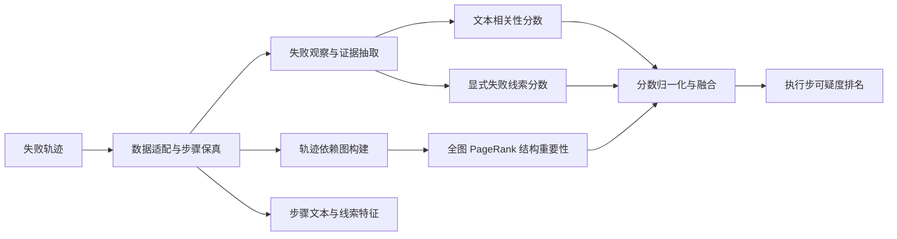

# LogHound-Agent-Debug 设计方案

## 1. 研究目标与边界

### 1.1 目标

给定一条已经失败的 coding-agent 执行轨迹，对其中所有候选执行步计算可疑度并降序排列。输出不只是一个根因步，而是一份与 LogHound 方法级排名同构的 step-level 排名，使 Top-K、MRR 和排序消融实验都可直接开展。

一条轨迹记为：

$$
\tau = (q, x_0, x_1, \ldots, x_{T-1}, f)
$$

其中 $q$ 是任务，$x_t$ 是第 $t$ 个执行步，$f$ 是轨迹中可观察到的失败结果。排序器输出：

$$
\pi(\tau) = [(t_1, s_{t_1}), (t_2, s_{t_2}), \ldots, (t_T, s_{t_T})]
$$

其中 $s_t \in [0,1]$，并满足 $s_{t_1} \ge s_{t_2} \ge \cdots \ge s_{t_T}$。

### 1.2 初版的“静态”含义

初版只读取已经保存的轨迹，不执行以下操作：

- 不重放环境；
- 不替换动作做反事实实验；
- 不重新运行测试或工具；
- 不要求访问产生轨迹时的代码仓库；
- 不调用 LLM 生成根因结论。

这与 LogHound 不依赖目标程序动态复现的出发点一致。AgenTracer 的反事实/故障注入只用于生成标签，不进入待评估排序器。

静态不等于“可以凭空制造失败证据”。排序器只能使用轨迹中已经记录的负向工具结果、测试输出、异常或终止状态。如果数据只有“这条轨迹最终失败”的 episode-level 标记，却没有任何 step-level 失败观察，则该条轨迹不满足 evidence-aware 主协议的输入资格；不能用 `mistake_reason` 或 `ground_truth` 补成失败证据。

### 1.3 初版明确不做的内容

- 不训练新的大模型；
- 不直接迁移 LogHound 的 Java AST、CodeQL 或方法调用图实现；
- 不把 AgentDebug 的 ALFWorld、GAIA、WebShop 数据称作 coding-agent 数据；
- 不在 AgenTracer 的官方 test 文件上学习权重；
- 不提前为 SWE-bench Pro 大规模标注。

## 2. 为什么不是机械地“方法换成步骤”

LogHound 的三个主要信号不能逐字段照搬，但可以迁移其证据融合结构：

| LogHound | Agent Debug 迁移 | 保留的思想 |
|---|---|---|
| 缺陷报告与源码方法的 VSM 相似度 | 任务/失败证据与执行步内容的文本相关性 | 信息检索产生候选可疑度 |
| 日志与异常栈中的方法 | 错误消息、失败测试、无效工具调用、终止症状所关联的步骤 | 运行线索比普通文本更直接 |
| 静态调用图上的路径重建与 PageRank | 时间、消息、agent、文件和工具依赖构成的轨迹图；在全图上运行非个性化 PageRank | 用全局结构重要性识别被多个后续步骤依赖的关键轨迹节点 |
| 测试覆盖率抑制广泛执行的方法 | 跨轨迹模板频率仅作为 PageRank 偏置诊断，不进入主版本融合 | 检查常见编排节点是否被结构通道过度奖励 |
| 多路归一化加权 | step-level 多路归一化加权 | 生成统一可疑度排名 |

最大差异是：LogHound 需要从不完整日志恢复执行路径，而 agent 轨迹已经给出实际顺序。因此这里不再“重建执行序列”，而是从序列上补建依赖边，再用全图 PageRank 衡量每个步骤在整条轨迹中的结构重要性。第三通道不使用失败步骤或其他可疑步骤作为传播起点，避免把已经暴露错误的症状节点再次加权。

## 3. 数据设计

### 3.1 数据集角色

| 数据 | 初版角色 | 原因 |
|---|---|---|
| AgenTracer coding test，127 条 | 主可行性数据源；按证据分档：9 条硬失败（A 档，主验证）、31 条弱证据（B 档，稳健性）、87 条 trace-only（C 档，对照） | 与 coding 任务最接近，已有单根因 step/agent 标签；step-level 失败观察部分存在（A/B 档共 40 条），且混合了注入故障痕迹，需按 3.1.1 分档 |
| <br />                | <br />  | <br />                                    |
| SWE-bench Pro                | 第二阶段外部测试集                                                              | 最接近最终科研目标，但需要先定义并完成人工标注                                                                    |

本地 AgenTracer 完整论文规模大于当前 127 条文件，但当前工作区只有 coding test 子集。设计和实验报告必须区分"论文数据规模"与"本地实际可用规模"。

#### 3.1.1 本地 127 条的实测证据分布（P0 审计结论，写代码前必须固化）

对 `content` 全文扫描（正则见 3.3）所得，作为后续脚本与报告的基线数字：

| 档位 | 判定条件 | 条数 | 说明 |
|---|---|---|---|
| A. 硬失败证据 | terminal 回传含 Traceback / AssertionError / FAILED / 异常栈 | 9 | `Filter_56113_I`、`Package_9114_I`、`Leetcode_7390_I`、`Leetcode_9277_I`、`Algorithm_35399_I`、`Apps_6606_I`、`Codeforces_7286_I`，以及仅 `command not found` 的 `Filter_17660_I`、`Codeforces_00027102_I` |
| B. 弱陈述证据 | 无回传，但 agent 文本明确陈述"previous attempt ... failed / failed due to syntax error"等 | 31 | 高度模板化（见 4.4 风险），多为注入故障的痕迹；不能与 A 档等同 |
| C. 无证据 | 无任何负向观察，正常走完流水线后 `Plan.finish_current_task`+`end` 收尾 | 87 | trace-only 对照 |

A+B 合并为 evidence-aware 合格集（40 条），但**主协议只以 A 档为强证据样本，B 档单独报告**。这与 4.2、5.5 和 P0 完成标准联动：不能只报"40 条 evidence-aware"，必须给出 9/31/87 三档拆分。

两个已核实的混淆检查结论，写 adapter 时直接使用：

- `*_attacked_solution.py` 文件名首现步均为 step 0（68/68）：文件名在任务正文里直接给出，**不作为泄漏源**，但语义通道需把文件名规范化（见 3.3），避免文件名 token 干扰 IDF；
- 首次写 solution 文件的 step 与标签根因步吻合 0/68："写代码首步"不是根因的可靠代理，位置/角色基线与图传播仍是必要成分。

### 3.2 统一输入 schema

建议 `inputs.jsonl` 每行结构如下：

```json
{
  "schema_version": "0.1.0",
  "dataset": "agentracer",
  "trajectory_id": "Algorithm_34582_I",
  "task": "...",
  "domain": "coding",
  "outcome": "failure",
  "failure_observations": [
    {"source_step_id": "22", "kind": "test_failure", "content": "...", "provenance": "trace"}
  ],
  "steps": [
    {
      "ordinal": 0,
      "source_step_id": "0",
      "source_event_ids": ["0"],
      "agent": "Team Leader",
      "role": "assistant",
      "raw_content": "...",
      "decision_text": "...",
      "action_text": null,
      "observation_text": null,
      "tool_name": null,
      "artifacts_read": [],
      "artifacts_written": []
    }
  ]
}
```

标签放在独立的 `labels.jsonl`：

```json
{
  "trajectory_id": "Algorithm_34582_I",
  "root_cause_steps": ["3"],
  "root_cause_agents": ["Product Manager"],
  "root_cause_modules": [],
  "root_cause_types": [],
  "reason": "...",
  "annotation_method": "fault_injection",
  "provenance": "agentracer"
}
```

`root_cause_steps` 从一开始就设计为数组，以兼容 AgentDebug 的最小根因集合以及未来 SWE-bench Pro 可能出现的多根因情况。`failure_observations` 是轨迹输入中已经存在的观察；规则抽取后的 `symptom_evidence` 属于中间结果，不能和标签一起写入原始 `inputs.jsonl`。

### 3.3 步骤边界

适配时必须遵守两个原则：

1. 保留原始 `source_step_id`，绝不因清洗或模块抽取而重新编号；
2. 排名单元是一个 agent decision step。初版 AgenTracer 中一个 history 元素对应一个 decision step；未来数据中可把一个 assistant 决策和其工具结果合并为一个 decision step，并在 `source_event_ids` 中保留原始事件映射；
3. 一条记录中的 thinking、command、message 不再拆成多个候选，但要解析为 `decision_text`、`action_text`、`observation_text`，并保留 `raw_content` 供审计。

可以把步骤内部进一步解析为 action、observation、tool 和 artifact 字段，但这些只是特征，不改变评估单元。未来适配 SWE-bench Pro 时，再额外建立"assistant 决策 + 工具结果"的 canonical decision 映射，并保留原始 event 到 decision 的映射表。

#### 3.3.1 content 的四段结构与回传解析（实测格式）

一条 thinking 帧的 `content` 按顺序混合四段内容：系统模板行（`# Past Experience` / `# Tool State` / `# Current Plan` 等）→ 任务复述/思考 → ```json 命令数组 → `Terminal output:` 回传块。回传块格式实测为：

```text
Terminal output: [command]: pwd  
[command output] : /data/home_data/R1-Tracer/MetaGPT/workspace
```

解析规则（P0 固化）：

1. `decision_text`：模板行剥离后的思考部分（保留任务复述作为理解意图的上下文）；
2. `action_text`：json 数组中的 `command_name` + `args`；
3. `observation_text`：用正则 `\[command\]:\s*(.*?)\n\[command output\]\s*:\s*(.*?)(?=\n\[command\]|$)` 提取全部 `(命令, 输出)` 对拼接；663 处回传中 614 处为 `pwd`（无信息但真实回传），非 pwd 约 50 处；
4. 命令 JSON 与回传位于**同一个 decision step**，因此工具调用边退化为节点内 observation，不跨节点建 self-loop（与 4.5 的约定一致，此处由实测确认）；
5. 系统模板行、被引用的任务正文、`attacked` 文件名均不进 `decision_text` 的语义文档；文件名统一替换为占位符 `<SOLUTION_FILE>`，防止文件名 token 干扰 IDF（见 3.1.1）。

### 3.4 AgenTracer 已确认的风险

- `history` 是 NumPy `ndarray`，不是 JSON 字符串；适配器要同时兼容数组和字符串化列表。
- 127 条标签都能正确映射，但轨迹长度从 2 到 151，不能只报告未归一化平均排名。
- Engineer 占根因 agent 的 72.4%，step 4 占根因步的 33.1%，存在强角色和位置先验。
- `ground_truth` 和 `mistake_reason` 在真实推理时不可获得，必须物理隔离。
- 文件名为 test；未经额外训练集支持，不可据此调权。
- 本地 AgenTracer Parquet 的 last-step 多数是"完成任务"的编排消息，但**并非完全没有 step-level 失败观察**：`content` 内嵌 663 处 `Terminal output` 回传（3.3.1），其中仅 9 条轨迹含真实硬失败、31 条仅 agent 陈述式弱证据、87 条无证据（3.1.1）。因此 evidence-aware 合格集只有 9 条强样本，**不得将 40/127 说成主验证集规模**；
- 大量弱证据高度模板化（"Since the previous attempt to create the file with content failed, ..."），本质是注入故障的痕迹而非自然测试失败；它只影响局部 clue 分，不得参与第三通道的 PageRank 初始化（4.4、4.5）；
- 同一条失败在轨迹内可能重复数十次（如 `Filter_56113_I` 相同 `AssertionError` 出现 10 次）。重复命中会使多个步骤获得局部 clue 分，因此仍需在报告中统计失败簇；但第三通道不使用失败 seed，不会因重复错误而改变 PageRank 的初始分布。

## 4. 初版排序算法

### 4.1 总体流水线



### 4.2 候选步骤与失败证据

候选集合是轨迹中的全部 decision steps。失败证据只从输入轨迹内部的结构化 observation 和负向终止状态提取，包括：

- 最终测试失败或评分失败；
- traceback、异常、非零退出码；
- 工具返回的 invalid、not found、timeout、permission 等错误；
- agent 明确陈述的未完成、无法继续或达到限制；
- 若没有显式错误但输入明确标记了负向终止，则使用最后一个负向 observation 作为弱终止证据；正常的"完成""提交成功"或"任务结束"消息不能作为 failure clue。

本地 AgenTracer 的 evidence 判定按 3.1.1 的档位执行，且必须满足证据来源约束：**只有 `[command output]` 回传（A 档）和 agent 陈述中的失败声明（B 档）算数；任务正文中出现的 `assert`、`Invalid input`、`avoid timeouts` 等词汇是任务说明，不是失败观察**。实现 clue 规则时必须显式剔除命中发生在系统模板行/任务复述段的情况（实现按 3.3.1 的段落切分后只扫描 observation_text）。

如果输入没有任何负向 observation，也没有明确负向终止状态，则标记为 `no_evidence`：不生成伪造的失败线索，`clue` 通道记为无信息；但第三通道只依赖轨迹结构，因此仍在全图上运行 PageRank。该状态用于区分“没有局部失败证据”和“图结构本身不可构建”，不能把 `no_evidence` 等同于第三通道无分数。

实验分成两个协议：

- `evidence-aware`：输入含至少一个真实负向 observation，运行 semantic、clue 和 PageRank 结构重要性三个通道，是主方法协议。主结果限定 A 档（9 条）并附逐条案例；B 档（31 条）作为弱证据稳健性子集单独报告，不并入主结果；
- `trace-only`：输入没有负向 observation（C 档 87 条），运行 task-only semantic 与 PageRank 结构重要性通道，clue 记为无信息。该分层用于观察在没有失败线索时，纯文本与结构重要性能够提供多少排序信息；不能把结果解释为 evidence-aware 完整方法效果。

任务文本 $q$ 用于理解意图，但正确答案 `ground_truth` 不得进入失败证据。

### 4.3 通道一：静态文本相关性

初版使用 TF-IDF cosine，避免模型调用和额外训练。查询由任务约束和失败观察组成，文档为每个步骤的 agent、`decision_text`、`action_text`、工具名和 artifact；`raw_content` 中重复的系统 prompt、Current Plan、Response Language 和被引用任务不进入语义文档。词表与 IDF 只在单条轨迹内部构建（文档集 = 该轨迹全部步骤 + 任务文本 + 失败观察），主版本不跨轨迹共享词表，避免语义通道携带跨样本信息。4.5 的模板特异性若被计算，也只作为诊断字段，不进入任一主通道得分。

单独使用“与任务相似”会偏向复述需求的早期步骤，单独使用“与错误相似”又会偏向最后的表面症状。因此保留两个子分数：

$$
S_{sem}(t) = \lambda_q \cdot cos(v_t, v_q) + (1-\lambda_q) \cdot cos(v_t, v_f)
$$

首版固定 $\lambda_q=0.4$，不在 test 上调参。权重敏感性（$0.2,0.4,0.6$）推迟到后续阶段补充；若补充，必须展示完整网格，不能只挑最好结果作为主结果。

### 4.4 通道二：显式失败线索

`clue` 模块只对结构化 `observation_text`、工具结果和负向终止状态抽取可解释规则特征，不扫描被引用的任务说明或系统 prompt。特征包括：

- 工具/命令执行失败；
- 测试失败、异常或错误码；
- 无效动作、参数或格式；
- 文件不存在、读写目标不一致；
- agent 自己承认假设错误、结果不符或无法完成；
- 纯环境/系统错误标记。

分数定义：规则表中每条规则 $r$ 记录判定逻辑（正则/字段条件）、类别和固定权重。主版本采用以下类别权重：terminal failure 为 1.0，tool/env failure 为 0.6，negative confession 为 0.4，弱终止为 0.3。对步骤 $t$，设 $R_t$ 为命中规则集合，局部线索分为命中规则权重的最大值：

AgenTracer 适配时把 3.3.1 解析出的 observation_text 作为规则扫描对象（不接受裸全文本扫描），并预注册以下本地规则族：

- terminal failure（1.0）：回传含 `Traceback` / `AssertionError` / `NameError` / `IndentationError` / `unittest` 的 `FAILED (errors=` 或 `AssertionError: Lists differ`；
- tool/env failure（0.6）：回传含 `command not found` / `No such file` / `Permission denied` / `ModuleNotFoundError`；
- negative confession（0.4）：`decision_text` 中 `previous attempt ... failed` / `failed due to (a )?(syntax|indentation|compile|runtime) error` / `test cases? ... failed`，且该句在 observation_text 之外（陈述句）；
- 显式排除（不计分）：上述词出现在任务正文复述段、系统模板行、或 agent 复述测试代码/文件中（如 `assert result == expected, f"Test failed..."` 是代码内容不是失败观察）。

B 档模板句（"Since the previous attempt to create the file with content failed, ..."）会命中 confession 规则。预注册时接受这一事实，但：a) 不得把它提升为 terminal failure；b) 在 3.1.1 的 B 档单独报告其贡献；c) 若它导致 clue 分散在非根因步，在 5.4 的错误分析中记录；当前阶段不做"去掉 confession 规则"消融。规则表应放在配置文件并为每次运行记录版本，不能在看到 test 标签后逐条补规则。

$$
S_{clue}(t) = \max_{r \in R_t} w_r
$$

未命中任何规则为 0；命中多条取最大值而非求和，避免大段报错文本因重复命中被放大。上述数值写入 `clue_rules.yaml` 并为每次运行记录版本。clue 只表示当前步骤上可直接观察到的局部失败证据，不参与 PageRank 的初始分布、随机跳转分布或边权计算；不能再用“绝对权重较小”解释其影响，因为 4.6 不对 clue 做轨迹内 min-max。

命中 terminal、tool/env 或 negative confession 的步骤记录为 `clue_hits`，用于解释局部得分和开展错误分析。即使输入明确为失败但没有规则命中，也不补造最后一步线索。`clue_hits` 不是 graph seed：某步的错误词数量、错误类别和 $S_{clue}(t)$ 都不会改变第三通道的 PageRank 结果。

规则表应放在配置文件并为每次运行记录版本，不能在看到 test 标签后逐条补规则。

### 4.5 通道三：轨迹图与全局 PageRank 结构重要性

先构建因果方向图 $G_c=(V,E_c)$，一个节点对应一个候选步骤。边从影响源指向被影响步骤，初版包括：

- 相邻时间边 $t \rightarrow t+1$（只用于保存完整轨迹顺序和诊断，不进入主版本 PageRank）；
- 同一 agent 的相邻决策边；
- 消息发送步骤到接收者后续步骤；
- 计划任务到完成该任务的步骤；
- artifact 写入步骤到后续读取/修改步骤；
- 工具调用到对应工具结果；如果结果已附着在同一个 decision step 内，则作为该节点的 observation，不额外创建候选节点。

主版本固定进入 PageRank 的边权为 artifact/tool 1.0、显式消息/任务 0.8、同 agent 0.5。如果同一对节点命中多种关系，边权取这些关系权重的最大值，避免重复关系人为放大；如果某类边无法可靠抽取，则缺省，不能凭文本猜出不存在的文件依赖。纯时间相邻边虽然记录在 $G_c$ 中，但不进入主版本 PageRank：在只有一条出边时，加权归一化会把 0.2 仍变为转移概率 1，导致普通时间链系统性奖励早期节点。将时间边纳入 PageRank 只能作为单独的结构敏感性分析。

PageRank 中一条边表示“源节点给目标节点投票”。为了让被多个后续步骤依赖的上游步骤获得更高结构重要性，在不改变 $G_c$ 的因果语义和审计输出的前提下，构造 PageRank 图：

$$
E_{dep}=\{(u,v,w)\in E_c\mid relation(u,v)\neq temporal\}
$$

$$
G_{pr}=(V,E_{pr}), \qquad (u,v,w)\in E_{dep}\Longrightarrow(v,u,w)\in E_{pr}
$$

也就是说，如果步骤 $u$ 影响步骤 $v$，则在 $G_{pr}$ 中由 $v$ 向 $u$ 投票。这只是确定普通 PageRank 的边方向，不是从失败症状开始反向传播。所有节点都参与计算，错误步骤、正常步骤和无错误证据的步骤具有相同的初始概率与随机跳转概率。

令 $P$ 为 $G_{pr}$ 的加权行随机转移矩阵，节点 $i$ 到节点 $j$ 的转移概率为 $w_{ij}/\sum_k w_{ik}$。对没有出边的悬挂节点，按标准 PageRank 做法将其概率均匀分配到全部 $T$ 个节点，而不是设置自环。令均匀分布 $u=\frac{1}{T}\mathbf{1}$，则：

$$
r^{(0)} = u, \qquad r^{(k+1)} = (1-\alpha)\,u + \alpha\,P^{\top}r^{(k)}
$$

迭代至 $\lVert r^{(k+1)}-r^{(k)}\rVert_1<10^{-6}$ 收敛，主版本固定 $\alpha=0.85$，并设置确定性的节点顺序和最大迭代次数。最终定义：

$$
S_{path}(t)=S_{pr}(t):=r_t
$$

该通道不读取 $S_{clue}$、`clue_hits`、evidence tier、失败类型或标签，因此对同一张轨迹图，无论识别出多少失败线索，$S_{path}$ 都必须完全相同。A/B/C 三档均运行 PageRank；只有节点数为 0 或图构建失败时才标记该通道不可用。单节点图的 PageRank 固定为 1；没有任何依赖边的多节点图得到均匀分布，按 4.6 的规则归一化后该通道贡献为 0。

第三通道的含义是“全局结构重要性”，而不是因果概率：一个高分步骤表示它被较多或较重要的后续步骤依赖，不保证它一定是根因。同 agent 链和早期编排节点仍可能引入位置偏置，因此必须在报告中同时给出 PageRank 排名、节点的加权入/出度、ordinal 分桶以及各类边覆盖率，用于检查某类关系或早期位置是否主导结果。

模板特异性 $S_{spec}$ 可继续作为诊断字段计算，用于观察常见编排步骤是否占据榜首，但主版本不再将其与 PageRank 相乘，否则第三通道将不再是常规 PageRank。若后续研究 coverage-aware 变体，必须作为独立、预注册的扩展实验报告，不能替换这里的主结果。

这样三个通道保持解耦：semantic 表示文本相关性，clue 表示局部显式失败线索，path 表示与失败线索无关的全图结构重要性。

实现时必须用自动化测试固定以下不变量：

1. 同一张依赖图在替换、增加或删除 `clue_hits` 后，PageRank 向量逐元素不变；
2. 对称节点获得相同分数，被多个高重要性后续节点共同依赖的上游节点获得更高分数；
3. 全悬挂图得到均匀分布，归一化后的 path 通道为全 0；
4. 默认计算的 $E_{pr}$ 中不存在纯时间相邻边，且改变失败证据不会改变 $E_{pr}$；
5. PageRank 概率和在数值误差内等于 1，重复运行的节点顺序、迭代次数和最终分数一致。

### 4.6 分数归一化与最终融合

semantic 和 path 在每条轨迹内部做 min-max 归一化。若一个通道的所有候选值相同，则该通道统一记为 0。clue 不做轨迹内 min-max，直接使用 4.4 中固定的 $[0,1]$ 类别权重，避免唯一一个症状命中被归一化为 1，也保留 terminal/tool/env 的预注册强弱关系。

沿用 LogHound 原型的融合比例作为不经 test 调参的起点：

$$
S(t) = 0.12 \cdot \widehat{S}_{sem}(t) + 1.0 \cdot S_{clue}(t) + 1.0 \cdot \widehat{S}_{path}(t)
$$

最终可再除以 2.12 映射到 $[0,1]$，这不改变排名。分数相同则按原始 `ordinal` 升序稳定打破平局，因为两套参考工作的根因定义都强调最早的决定性错误。

### 4.7 输出格式

```json
{
  "trajectory_id": "Algorithm_34582_I",
  "evidence_status": "ok",
  "ranking": [
    {
      "rank": 1,
      "source_step_id": "3",
      "agent": "Product Manager",
      "score_raw": 1.657,
      "suspiciousness": 0.782,
      "components": {
        "semantic_normalized": 0.31,
        "clue": 0.70,
        "pagerank": 0.042391,
        "path_normalized": 0.92
      },
      "evidence": ["high_graph_importance", "writes_reused_artifact"]
    }
  ],
  "clue_hits": [{"source_step_id": "22", "score": 1.0, "category": "terminal_failure"}],
  "graph_stats": {"nodes": 23, "causal_edges": 41, "pagerank_edges": 18, "pagerank_converged": true, "pagerank_iterations": 18, "dangling_nodes": 1},
  "config_hash": "...",
  "input_hash": "..."
}
```

组件分数和证据必须保留，否则无法做错误分析，也无法判断模型是因为语义、位置偏置还是图结构命中。

## 5. 实验方案（单一迁移实验）

### 5.1 当前阶段目标

当前阶段只做一个实验，回答一个问题：

> LogHound 的证据融合方法（语义 + 显式线索 + 全图 PageRank 结构重要性的三路静态融合，见 4.3–4.6）迁移到 agent 执行轨迹后，能否把根因步骤排到足够靠前。

实验对象为本地 AgenTracer coding test 的 127 条轨迹，使用预先固定的配置和规则运行一次完整流程。当前不做：

- 随机、位置、角色或单通道基线对比；
- 各通道贡献的消融与权重敏感性；
- 跨域验证或其他额外数据集实验。

实验不在 test 上调参：$\lambda_q=0.4$、$\alpha=0.85$、4.6 的融合权重均使用预注册固定值，规则表随运行记录版本。

### 5.2 评估口径

本实验只运行当前方法一次；A/B/C 三档是同一实验中的数据分层，不构成额外实验：

- A 档 9 条强证据：作为主要结果，在汇总指标之外逐条给出真实根因、排名与证据链；
- B 档 31 条弱陈述证据：作为同一实验的补充分层结果单独报告，不与 A 档混算；
- C 档 87 条无证据轨迹：按照 4.2 的 `no_evidence` 规则运行并单独报告，用于说明无失败证据时的适用边界，不将其结果解释为完整方法效果。

所有规则表（clue_rules.yaml）与配置 hash 必须在看到 test 标签前固定（4.4、4.6）。报告只给出当前方法的绝对效果，不出现“优于 X”或通道贡献的表述。

### 5.3 指标

主指标保持不变（评估单元与 4.2 一致）：

- Hit@1、Hit@3、Hit@5；
- MRR；
- Mean Rank 与 Median Rank；

统计报告口径：

- A 档（9 条）：样本过小不做 bootstrap，逐条报告真实根因的排名、NR、组件分数与 evidence；
- B 档（31 条）：汇总指标并注明样本量局限；
- C 档（87 条）：单独列一节或排除，不与主结果混算；
- 按短轨迹 $T \le 10$、中轨迹 $10<T\le30$、长轨迹 $T>30$ 分层；
- 按根因 agent 和根因位置分桶，观察命中分布（只记录现象，不做偏置归因结论）；
- 报告真实根因步骤在第三通道中的 PageRank 排名，以及其加权入/出度、ordinal 分桶；同时报告各类图边覆盖率，检查结构分是否被同 agent 链或位置先验主导。

注意：本实验没有基线或消融对照，绝对指标只用于判断迁移后的方法能否定位根因。

### 5.4 报告内容与错误分析

输出格式与 4.7 一致（逐轨迹 ranking JSONL + 组件分数 + evidence + clue_hits + graph_stats + 汇总 CSV），本实验报告重点：

1. A 档 9 条逐条案例卡：真实根因、方法给出的 Top-1/Top-3、各组件归一化分数、evidence 列表、根因的 PageRank 排名及加权入/出度；
2. B 档：核对 confession 模板句（3.4、4.4）是否把局部 clue 分散布到非根因步，并确认它不会改变 PageRank 分数；
3. C 档：记录无证据输入下的表现，验证 4.2 的 no_evidence 门控只关闭 clue、PageRank 仍按全图结构正常运行；
4. 错误分类统计：标签争议、根因无显式证据、图边缺失、症状误判、模板偏置，作为判断迁移方案是否需要后续改进的依据。

### 5.5 完成标准与后续阶段

本实验完成标准：

1. 一条命令可从 raw 数据复现 prepare → run → evaluate 全流程，重复运行排名与指标一致；
2. A 档 9 条逐条案例表完整产出，能说明每条的真实根因命中情况、组件分数与结构信息；
3. 汇总指标在 A 档给出、B 档单独给出、C 档单列；
4. 人工抽查至少 30 条（A 档全查 + B/C 抽样），确认高排名结果是否来自有效依赖关系，而不只是末尾错误词匹配、同 agent 链或其他位置偏置；B 档特别核对 confession 模板句是否只影响 clue、不会改变 PageRank；
5. 明确记录：实验结论只描述迁移方法的绝对效果，不含基线、消融或跨域结论。

通过后再决定是否进入 SWE-bench Pro 标注。若未通过，先按错误分析判断是数据域不匹配、步骤图抽取失败，还是“静态证据不足以识别反事实根因”。

## 6. 实施结构

目录只服务于第 5 节的单一迁移实验：当前实现 AgenTracer adapter、三路融合排序和统一评估；不设置基线/消融目录，也不加入 AgentDebug 数据或阶段。SWE-bench Pro 仅作为未来可能的数据扩展预留。

```text
loghound-agent-debug/
├── README.md
├── docs/
│   ├── DESIGN.md
│   └── experiment_log.md
├── data/
│   ├── README.md
│   ├── rawdata-intro.md
│   ├── raw/{agentracer,swebench_pro}/
│   ├── interim/
│   ├── processed/
│   ├── splits/
│   └── metadata/
├── configs/
│   ├── default.yaml
│   └── clue_rules.yaml
├── src/loghound_agent_debug/
│   ├── schema.py
│   ├── adapters/agentracer.py
│   ├── evidence.py
│   ├── graph.py
│   ├── features/{semantic,clue,specificity}.py
│   ├── rankers/loghound_static.py  # 三路融合主方法
│   ├── evaluate.py                 # Hit@K/MRR/NR 与 A/B/C 分层结果
│   ├── reporting.py                # 逐条案例卡与错误分类（5.4）
│   └── cli.py
├── scripts/
│   ├── view_parquet.py
│   ├── prepare_data.py
│   ├── run_experiment.py
│   ├── case_report.py              # 生成 5.4 的逐条案例卡与错误统计
│   └── audit_data.py
├── tests/
│   ├── test_adapters.py
│   ├── test_no_label_leakage.py
│   ├── test_graph_direction.py
│   ├── test_scoring.py
│   └── test_metrics.py
├── outputs/                 # 运行生成，不提交大文件
│   ├── rankings/            # 逐轨迹 ranking JSONL（4.7）
│   ├── metrics/             # 汇总 CSV 与 A/B/C 分层结果
│   └── cases/               # 案例卡与错误分类（5.4）
└── pyproject.toml
```

所有 Python 命令统一使用用户指定的 `mybook` 环境：

```bash
conda run -n mybook python ...
```

## 7. 分阶段执行计划

### P0：数据与防泄漏

- 实现统一 schema 和 AgenTracer adapter；
- 生成 `inputs.jsonl` 与 `labels.jsonl`；
- 自动验证 step 唯一性、agent 对齐、缺失值和长度；
- 写 `test_no_label_leakage.py`，确保 ranker API 无法访问 label 对象；
- 审计失败观察存在率、clue 命中覆盖率、规则误报率、各类图边覆盖率、PageRank 悬挂节点比例和 specificity singleton 比例；
- 固化数据校验和和运行配置。

完成标准：127 条全部通过映射检查，转换前后 step 数和内容 hash 不变；审计脚本输出 3.1.1 的 9/31/87 三档划分并写入 `data/splits/evidence_split.json`（含每条轨迹的 evidence 类型、clue hit 步骤列表、重复失败簇数）；验证 3.3.1 的段落切分与任务正文误报排除规则在抽查样本上无误报。若审计后 A 档仍不足 9 条，主方法验证以逐条案例报告为主，不得宣称已通过 bootstrap 级验证。

### P1：单一迁移实验实现

- 实现当前方法主流程（semantic、clue、graph/PageRank 与三路融合，并输出 specificity 诊断字段）；
- 实现 failure observation 解析、decision_text/action_text/observation_text 抽取与 clue 规则；
- 实现轨迹因果图、反向依赖图上的非个性化 PageRank、specificity 诊断字段和三路融合；
- 输出逐轨迹排名 JSONL 和汇总 CSV。

完成标准：一条命令可从 raw data 生成可复现实验结果，重复运行排名一致。

### P2：单一实验评估与错误分析

- 计算 Hit@K、MRR、NR 和 A/B/C 分层结果；
- 生成逐条案例与错误分析；
- 人工抽查至少 30 条：命中、近失、完全失败各 10 条；
- 记录失败类型：标签争议、根因无显式证据、图边缺失、症状误判、模板偏置。

完成标准：能根据单一迁移实验结果对是否进入 SWE-bench Pro 标注给出明确 go/no-go 结论。

### P3：SWE-bench Pro

通过第 5.5 节完成标准后再启动。建议标注规范：

- 标注“最早的、若被正确替换可显著改变失败结局的 agent 决策步”；
- 允许多个互相独立的根因组成最小集合；
- 区分 agent 错误与纯工具/环境错误；
- 保存 root step、直接证据、因果链、可行修复和置信度；
- 两名标注者独立标注，冲突由第三人裁决；
- 先做 20 条 pilot，计算一致性并修订指南，再扩大规模。

## 8. 推荐的论文主张边界

初版若成功，最稳妥的结论是：

> LogHound 的“文本证据 + 运行线索 + 全图结构重要性 + 排名融合”范式，可以在不重放 agent 环境的条件下迁移为执行步级根因排序，并在 AgenTracer coding test 上展现出执行步级定位效果；本实验只报告该迁移方法的绝对结果。

初版不能声称：

- 已经解决真实 SWE-bench Pro coding-agent 调试；
- 静态排名等价于严格的反事实因果识别；
- 在 127 条 test 上调出的最佳权重能够泛化。

这个边界既保留了 LogHound 迁移的研究贡献，也避免把“相关性排序”过度解释为已经验证的因果根因。
